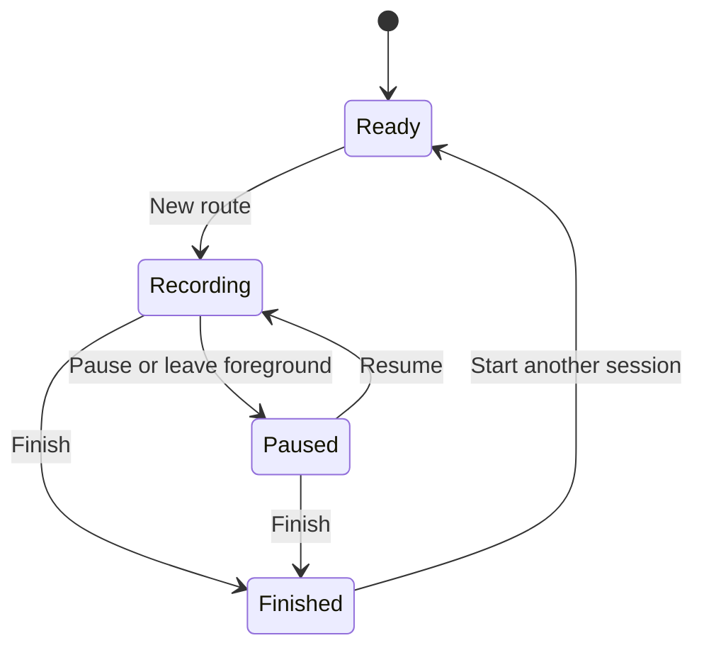

# RouteLog — GPS Route Tracker

**RouteLog by SABBIR AHAMMED**

> **Every route, remembered.** Record your journey. Explore your progress.


## Overview

**RouteLog** is a Flutter Android application for recording GPS locations, displaying movement on Google Maps, and managing multiple saved route sessions. Built around a Google Maps and location-tracking assignment, it extends the core map, marker, camera, and polyline features with named sessions, local persistence, route customization, and tools for comparing overlapping journeys.

Users can start a route, pause and resume recording, finish a session, and return later to review it. Each route has its own name, color, and line style. A clear separation between recording and map visibility makes it possible to inspect an older route while another session is active.

The central tracking flow is:

**Start route → check location permission → receive GPS coordinates → update marker and route segment → save locally → display the updated path.**

The Flutter project name is **`googlemapsdemo`**. The project is branded **RouteLog — GPS Route Tracker**. To match the app UI to this README, change the existing `Route Journal` title strings in `lib/main.dart` and `lib/map_screen.dart` to `RouteLog`.

## ✨ Features

### Google Maps and location

- Interactive Google Map with panning, zooming, and standard map controls
- Red marker for the latest GPS location
- Tappable location info window with latitude, longitude, and reported accuracy
- Translucent circle showing the latest reading's reported accuracy radius
- Location checks scheduled every **10 seconds** while actively recording
- High-accuracy location requests with a **20-second timeout**
- Protection against overlapping location requests
- **Find me / recenter** button that centers on an available reading and requests a fresh one
- **Follow me** toggle to center the camera as new readings arrive
- **Fit selected route** control to view the selected session's complete recorded extent
- Start and latest/finish markers for the selected route
- Camera handling for a single point, repeated positions, and routes crossing the longitude boundary

### Route session management

- Create multiple independent, named route sessions
- **New route**, **Pause**, **Resume**, and **Finish** controls
- One unfinished session at a time
- Resume the same paused route in a new continuous segment
- Finished sessions remain available for viewing, editing, and deletion
- Saved-route list with names, dates, statuses, distances, styles, and point counts
- Select a saved route and fit its path on the map
- Rename a route, including after it has finished
- Confirmation before finishing or deleting a session
- Delete an individual saved route
- Delete the current recording and stop collecting points for it
- Reject late GPS results after deletion or a recording-state change

### Colors, styles, and overlapping paths

- Eight route color choices: blue, red, green, purple, orange, teal, pink, and brown
- **Solid**, **dashed**, and **dotted** line styles
- Edit colors and styles without changing recorded coordinates
- **Selected only** mode for inspecting one route clearly
- **Compare** mode for viewing multiple non-hidden routes
- Wider, fully colored, outlined rendering for the selected route
- Thinner, faded rendering for other visible routes
- Selected route drawn above other paths
- Individual eye controls to hide or show routes in Compare mode
- Tap a visible route line to select it
- Select completely covered routes through the saved-route list
- Only the selected route receives endpoint markers, reducing map clutter

### Local persistence and recovery

- Automatic saving after route changes and accepted recording updates
- Restore multiple sessions after closing and reopening the app
- Preserve route names, colors, line styles, creation times, statuses, and segmented points
- Restore unfinished recordings as **paused** rather than automatically restarting collection
- Ordered save operations so older writes cannot overwrite newer changes
- Snapshot data before queuing a write
- Write to a temporary file before replacing the saved JSON file
- Visible save-failure message with **Retry save**
- Block new recording if the stored session file cannot be read, protecting existing data
- Preserve deletion and customization after a successful save and restart

### Statistics and user experience

- Estimated distance for each session
- Sampled duration across its continuous segments
- GPS reading count and reported accuracy
- Exclude unrecorded pause gaps from distance and duration
- Material 3 interface with a blue-based theme
- Route-name validation and a 60-character input limit
- Named color choices, selection indicators, tooltips, and semantic labels
- Scrollable route editor and saved-route list
- Location progress indicator and recording/save status messages
- Settings shortcuts when device location is off or app permission is blocked

## 📍 Recording Behavior

| App/session state | Location collection | Saved-route behavior |
| --- | --- | --- |
| App open, no active recording | Manual Find me can update the latest location | No route points are added |
| Recording in foreground | A location check is scheduled every 10 seconds | Accepted points are appended and saved |
| Session paused | Automatic route collection stops | Existing points remain; Resume starts a new segment |
| App hidden or backgrounded | Recording pauses | The unfinished session is retained; explicit Resume is required |
| App closed and reopened | No closed-app movement is reconstructed | Saved routes return; unfinished recording restores as paused |
| Session finished | No more points are added to that session | It remains viewable, editable, and deletable |
| Route hidden on the map | Visibility changes only | Data stays saved; hiding does not stop an active recording |
| Route deleted | Recording for that route stops if necessary | Its entry is removed when the save completes |



> Tracking is **foreground-only**. Local saving preserves already recorded points; it does not collect GPS positions while the app is closed. On reopening, tap **Resume** to continue an unfinished session.

A slow GPS request can delay an update. If a previous request is still running, the next scheduled check is skipped. The 10-second interval is a request schedule, not a guarantee of one new GPS fix at each exact interval.

## 🧭 Understanding Routes and Overlaps

### Recorded paths versus road navigation

A route is drawn by connecting sampled coordinates directly. If the app records only two positions, the result is one straight line. More readings along a road create a more detailed path, but corners may still be cut between samples.

This application does not calculate driving directions, snap points to roads, or reconstruct movement that was not recorded.

### Compare without losing clarity

| Display option | Best use |
| --- | --- |
| Selected only | Inspect one session, especially when paths coincide exactly |
| Compare | Compare several visible sessions on the same map |
| Color and line style | Give sessions distinct visual identities |
| Selected-route highlighting | Bring the chosen path to the foreground |
| Eye controls | Temporarily remove other paths from the comparison |
| Saved-route list | Select a route that another line completely covers |

Exact overlaps cannot all be fully visible at the same time. RouteLog lets users select or isolate them without shifting the recorded geographic coordinates. Hiding changes the display; deleting changes the saved data.

### Pause gaps

A route contains separate continuous segments. Pausing and resuming creates a new segment, so the app does not draw a misleading straight line across the unrecorded gap. Estimated distance and sampled duration also exclude that gap.

## 🧰 Technology Stack

| Technology | Role |
| --- | --- |
| Flutter / Dart | Interface and application logic |
| `google_maps_flutter` | Google Map, markers, circles, polylines, and camera controls |
| `geolocator` | Device location, accuracy, permission checks, and settings access |
| `path_provider` | Location of the app's documents directory |
| `ChangeNotifier` | Controller-to-interface updates |
| `WidgetsBindingObserver` | App lifecycle awareness |
| Dart `Timer` | Scheduled foreground location checks |
| Dart `dart:convert` | JSON serialization and deserialization |
| Dart `dart:io` | Local file storage |
| `flutter_test` | Model, controller, storage, and editor tests |

## 🧱 Architecture and Project Structure

The map screen handles presentation and camera actions. `TrackerController` manages session state, location requests, lifecycle transitions, and persistence feedback. `RouteSession` represents a recorded journey, while `SessionRepository` separates storage from controller logic. The file-based implementation is `JsonSessionRepository`.

The controller accepts an injected location reader and repository, allowing logic tests to run with controlled data instead of requiring live GPS.

| Path | Responsibility |
| --- | --- |
| `lib/main.dart` | Application entry point and Material 3 theme |
| `lib/map_screen.dart` | Map, route editor, session list, comparison controls, and camera actions |
| `lib/tracker_controller.dart` | Recording state, timer, permissions, lifecycle, and save feedback |
| `lib/route_session.dart` | Route models, JSON conversion, distance, and sampled duration |
| `lib/route_store.dart` | Session repository interface and ordered JSON file persistence |
| `test/route_sessions_test.dart` | Model, storage, controller, and failure-handling tests |
| `test/widget_test.dart` | Route name, color, and style editor test |
| `android/app/src/main/AndroidManifest.xml` | Android permissions and Google Maps key reference |
| `android/app/src/main/res/values/maps_api.xml` | Local API-key resource; excluded from Git |
| `pubspec.yaml` / `pubspec.lock` | Dependencies and resolved package versions |

## 🚀 Getting Started

### Prerequisites

- Flutter SDK compatible with the project's resolved dependencies
- Android Studio or another Flutter-capable editor
- Android SDK and the Java runtime required by the Flutter Android toolchain
- Android device or emulator with Google Play services and location enabled
- Minimum Android API **24**, matching this project's Maps setup
- A Google Maps API key authorized for Maps SDK for Android and this app

The implemented and manually tested target is **Android**. This project uses local file storage and has not been validated as a browser application or iOS release.

### Open and install

Clone or download this repository and open its project root, where `pubspec.yaml` is located.

For the development folder used in this project:

```powershell
cd D:\googlemapsdemo
flutter doctor
flutter pub get
```

The application uses these packages:

```text
google_maps_flutter
geolocator
path_provider
```

Install the versions resolved by the repository's `pubspec.yaml` and lockfile. An existing earlier version of this assignment can add the storage dependency with:

```bash
flutter pub add path_provider
```

### Configure the Google Maps key

Create the following local file:

```text
android/app/src/main/res/values/maps_api.xml
```

```xml
<?xml version="1.0" encoding="utf-8"?>
<resources>
    <string name="google_maps_key" translatable="false">YOUR_GOOGLE_MAPS_API_KEY</string>
</resources>
```

Replace the placeholder with your authorized key. Add this line to the root `.gitignore`:

```gitignore
/android/app/src/main/res/values/maps_api.xml
```

In `android/app/src/main/AndroidManifest.xml`, reference the resource inside `<application>`:

```xml
<meta-data
    android:name="com.google.android.geo.API_KEY"
    android:value="@string/google_maps_key" />
```

Declare these permissions directly inside `<manifest>`, outside `<application>`:

```xml
<uses-permission android:name="android.permission.INTERNET" />
<uses-permission android:name="android.permission.ACCESS_COARSE_LOCATION" />
<uses-permission android:name="android.permission.ACCESS_FINE_LOCATION" />
```

Preserve the existing Flutter activity, themes, and embedding configuration. Do not duplicate entries already present. The key belongs in its own `maps_api.xml`; keep `styles.xml` unchanged.

The project's Android application ID is **`com.googlemapsdemo.googlemapsdemo`**. Match any Android key restriction to the actual application ID and signing certificate used by your checkout.

In `android/app/build.gradle.kts`, the configured minimum Android version is:

```kotlin
minSdk = 24
```

Keep a higher value if the project already requires one. A training key can depend on its owner's project configuration, restrictions, and continued availability.

### Run the application

Start an emulator or connect an Android phone with USB debugging enabled:

```bash
flutter devices
flutter run
```

Choose the Android target. Allow location access **while using the app**, and choose precise location when offered. If the permission flow pauses a session, return to the app and tap **Resume**.

Adding a native plugin or changing Android configuration requires a full stop and rebuild rather than only hot reload.

## 🗃️ Local Route Data Model

Sessions are stored in **`route_sessions_v2.json`** inside the Android app's documents directory. The root object contains a schema `version` of `2` and a `routes` array.

| Session field | Type | Purpose |
| --- | --- | --- |
| `id` | String | Unique identity for the route |
| `name` | String | User-editable route name |
| `color` | Integer | Route color encoded as ARGB |
| `createdAt` | UTC ISO 8601 string | Session creation time |
| `pattern` | String | `solid`, `dashed`, or `dotted` |
| `status` | String | `recording`, `paused`, or `finished` |
| `segments` | Array of point arrays | Continuous sections separated by unrecorded gaps |

Each GPS point contains:

| Point field | Type | Purpose |
| --- | --- | --- |
| `lat` | Number | Latitude |
| `lng` | Number | Longitude |
| `time` | UTC ISO 8601 string | GPS reading timestamp |
| `accuracy` | Number | Reported accuracy in meters |

The stored format is validated before restoring it. Invalid coordinates, malformed structures, duplicate route IDs, and multiple unfinished sessions are rejected.

Save operations are queued and snapshot data immediately. This prevents an older queued save from undoing a newer deletion or customization. A failed save leaves a visible retry action.

> Wait for the saved status before closing the app. An abrupt termination during a write can lose the latest unsaved change. Clearing app data, uninstalling, or wiping the emulator can remove the local history; this version has no cloud backup.

View preferences—comparison mode, hidden routes, and Follow me—reset on restart. Stored sessions, names, colors, patterns, and points remain after a successful save.

## 🧪 Testing the Application

### Automated checks

From the project root:

```bash
flutter analyze
flutter test
```

The included suite contains **12 tests** covering:

- JSON round-trip preservation of routes, styles, and segments
- Invalid-coordinate rejection
- Ordered writes and persistence of deletions and recoloring
- Malformed-file handling
- Restoration of unfinished sessions as paused
- Pause/resume segmentation and independent new sessions
- Rejection of late GPS results after deletion or backgrounding
- Comparison and visibility behavior
- Protection against overwriting data after a load failure
- Save failure and retry
- Route-editor name validation and selected color/style output

The editor test replaces Flutter's original counter-app test, which no longer matches this application.

### Emulator movement test

1. Open **Extended Controls → Location** on the Android emulator.
2. Select a starting point and click **Set location**.
3. Start a route in the app.
4. Keep the app visible, move the simulated position along a road, and click **Set location** again.
5. Wait for a recorded update before moving to the next point.
6. Verify that the marker and route line update.

Instantly moving the emulator between two positions creates a straight connection between sampled points. To test a bend in the road, provide intermediate points around the turn.

### Session and persistence checklist

- [ ] Record and finish a named route.
- [ ] Create another session with a different color and style.
- [ ] Compare both routes and isolate each using Selected only.
- [ ] Hide and show a route without deleting it.
- [ ] Rename and recolor a saved session.
- [ ] Pause, change position, resume, and check that no line crosses the gap.
- [ ] Wait for saving, close the app, and confirm the sessions restore.
- [ ] Delete a route, wait for saving, reopen, and confirm it stays deleted.
- [ ] Leave the app while recording and confirm it returns paused.
- [ ] Check recenter, follow-location, fit-route, and coordinate info windows.
- [ ] Disable location or deny permission and check recovery behavior.

## ✅ Validation

| Check | Recorded status |
| --- | --- |
| Core map, GPS marker, camera, and polylines | Confirmed during Android emulator testing |
| Multi-session management, overlap controls, customization, and persistence | Confirmed during manual feature testing |
| Dart source/test syntax checks | Passed for the delivered seven Dart files |
| Route data model analysis | No issues found |
| Offline model/controller/storage checks | 18 assertions passed; platform boundaries were substituted for controller checks |
| Full Flutter analyzer and included Flutter test suite | Final checkout results have not been recorded; run the commands above |

Offline checks do not validate native Google Maps rendering or real-device GPS. The application was reported working during manual emulator testing; automated test results should be retained separately for the checkout being submitted.

## 🎨 Visual Identity

The interface uses a Material 3 theme generated from **Blue `#1565C0`**. Each session can choose a route color independently.

| Route color | Hex |
| --- | --- |
| Blue | `#1565C0` |
| Red | `#C62828` |
| Green | `#2E7D32` |
| Purple | `#6A1B9A` |
| Orange | `#EF6C00` |
| Teal | `#00838F` |
| Pink | `#AD1457` |
| Brown | `#5D4037` |

A selected route uses a stronger stroke and a light outline. Other visible routes are faded. Color names, selected-state indicators, and line styles help distinguish routes without relying on color alone.

## 🛡️ Configuration and Location Data

- Keep the local Maps key file out of Git. Adding an ignore rule does not remove a file already tracked or erase earlier commits.
- The key is embedded in the built app even when excluded from source control; configure appropriate restrictions on its owning project.
- Route files are stored locally in the app's documents directory. This implementation does not upload route history to an application backend.
- Google Maps loads map content through Google's services; local route storage does not make the map an offline map.
- Do not commit real route-history files or private coordinates as demo fixtures.
- The application requests foreground location permissions and does not implement a background-location service.
- Location data is retained until the route is deleted or the app's local data is removed.
- Configure release signing before distributing a production build; the development Gradle configuration uses debug signing for release builds.

## ⚠️ Current Scope and Limitations

- **Foreground recording only:** movement while backgrounded, paused, or closed is not recorded or reconstructed.
- **Sampled paths:** points are joined directly, without road routing or map matching.
- **Estimated distance:** GPS noise can increase the total, while sparse sampling can miss turns.
- **Sampled duration:** measures time between readings within each segment; it is not a live stopwatch and excludes waiting before the first fix.
- **Potentially stale marker:** the latest location remains displayed until another reading arrives.
- **One unfinished session:** finish or delete the current session before creating another.
- **Local history:** no account system, cloud synchronization, GPX/CSV export, or remote backup is implemented.
- **Practice-scale storage:** a large long-term history would benefit from database storage and route simplification.
- **Platform coverage:** Android is the configured test target; iOS and web support are not claimed.

## 📦 Assignment Submission

Submit this project's GitHub repository link with **`pubspec.yaml` at the repository root**. Include the application source, Android project, dependency lockfile, tests, and documentation.

Exclude generated build output, `.dart_tool/`, machine-specific paths, signing secrets, and the local API-key file. Keep setup instructions so a reviewer can configure an authorized key for their own checkout.

Useful demonstration screenshots include:

1. A recorded route with the location marker and statistics.
2. The saved-route list showing multiple named sessions.
3. Compare mode with distinct route colors and styles.
4. The name/color/style editor.

Use screenshots from the running app. Before submission, verify location permissions, recording, pause/resume gaps, session management, customization, overlap controls, restart persistence, deletion, and camera controls. Keep the foreground-only limitation explicit in the demonstration.

## 👤 Author

**SABBIR AHAMMED**

- [GitHub — SABBIR-FOUNDER](https://github.com/SABBIR-FOUNDER)
- [LinkedIn — SABBIR AHAMMED](https://www.linkedin.com/in/sabbir911/)

---

**RouteLog by SABBIR AHAMMED**  
*Every route, remembered.*
